# BabyClothes — Diagramas de Arquitetura

> Total: **33 endpoints** em 7 controladores · **7 schemas Ecto** · **10 migrations** · **2 grafos LangGraph** · **13 rotas SvelteKit**

---

## 1. Diagrama de Casos de Uso

```mermaid
graph TB
  %% Atores
  U([Usuário])
  S([Vendedor PF/PJ])
  A([Agente IA])
  Admin([Admin])

  %% Casos de uso - Autenticação
  subgraph Auth["Autenticação"]
    LOGIN[Fazer login com Google]
    REGPF[Registrar como PF com CPF]
    REGPJ[Registrar como PJ com CNPJ]
    LOGOUT[Fazer logout]
  end

  %% Casos de uso - Catálogo
  subgraph Catalog["Catálogo"]
    BROWSE[Navegar por categorias]
    FILTER[Filtrar por tamanho/gênero/condição]
    SEARCH[Buscar itens]
    VIEW_ITEM[Ver detalhes do item]
  end

  %% Casos de uso - Anúncios
  subgraph Items["Anúncios"]
    CREATE_ITEM[Criar anúncio<br>2-step form]
    EDIT_ITEM[Editar anúncio]
    REMOVE_ITEM[Remover anúncio]
    ADD_PHOTO[Adicionar fotos<br>drag & drop]
  end

  %% Casos de uso - Crianças
  subgraph Child["Gestão Infantil"]
    REG_CHILD[Cadastrar criança]
    ADD_MEASUREMENT[Adicionar medida<br>peso/altura/size]
    VIEW_GROWTH[Ver curva de crescimento]
    LIST_CHILDREN[Listar crianças]
  end

  %% Casos de uso - Agente IA
  subgraph Agent["Assistente IA"]
    CHAT[Conversar com assistente<br>SSE streaming]
    RECOMMEND[Receber recomendações<br>de tamanho]
    PREDICT[Prever próximo tamanho<br>Growth Graph]
    GROWTH_ALERT[Receber alerta de crescimento]
  end

  %% Casos de uso - Notificações
  subgraph Notif["Notificações"]
    VIEW_NOTIF[Ver notificações]
    MARK_READ[Marcar como lida]
    MARK_ALL_READ[Marcar todas como lidas]
  end

  %% Relacionamentos
  U --> LOGIN
  U --> LOGOUT
  U --> BROWSE
  U --> FILTER
  U --> SEARCH
  U --> VIEW_ITEM
  U --> CHAT
  U --> RECOMMEND
  U --> VIEW_NOTIF
  U --> MARK_READ
  U --> MARK_ALL_READ
  U --> REG_CHILD
  U --> LIST_CHILDREN
  U --> ADD_MEASUREMENT
  U --> VIEW_GROWTH
  U --> REGPF

  S --> REGPJ
  S --> CREATE_ITEM
  S --> EDIT_ITEM
  S --> REMOVE_ITEM
  S --> ADD_PHOTO

  A -.-> PREDICT
  A -.-> RECOMMEND
  A -.-> GROWTH_ALERT
```

## 2. Diagrama de Atores e Papéis

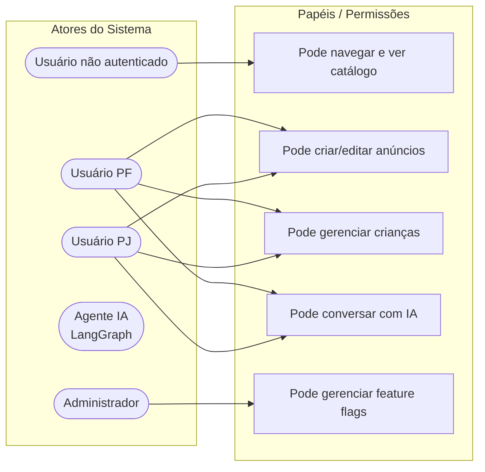

## 3. Diagrama de Arquitetura do Sistema

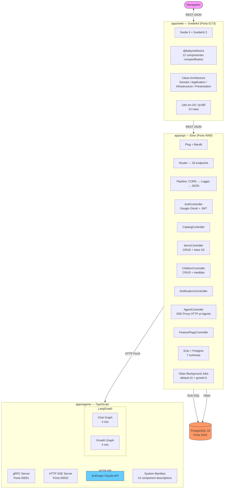

## 4. Diagrama de Sequência — Fluxos Principais

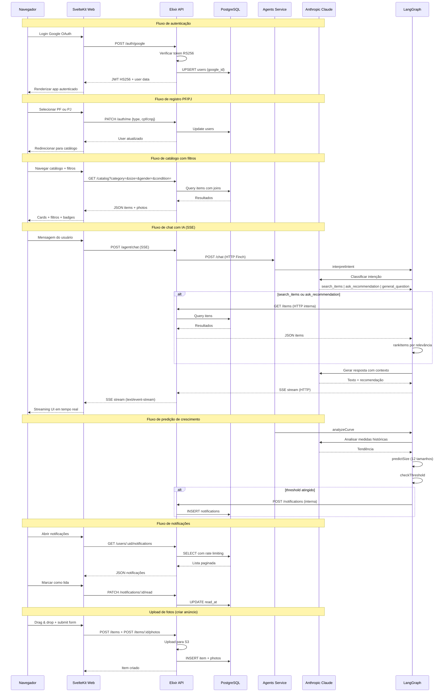

## 5. Diagrama de Grafos dos Agentes (LangGraph)

### Chat Graph

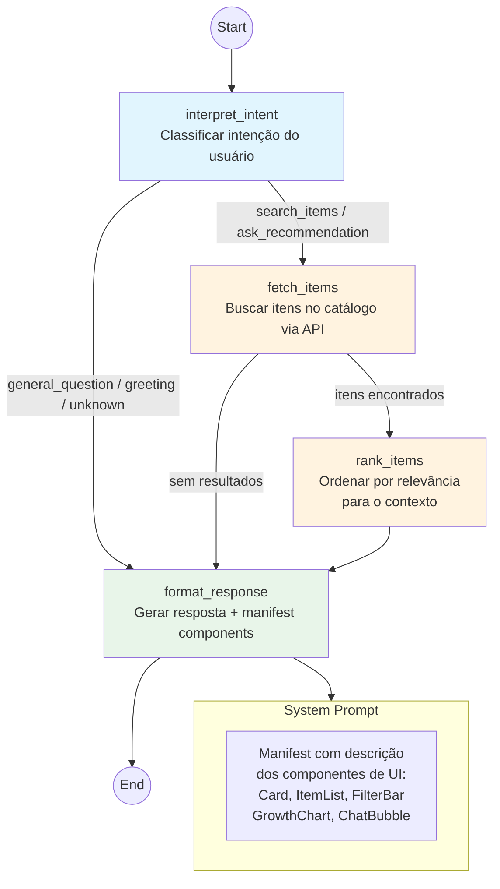

### Growth Graph

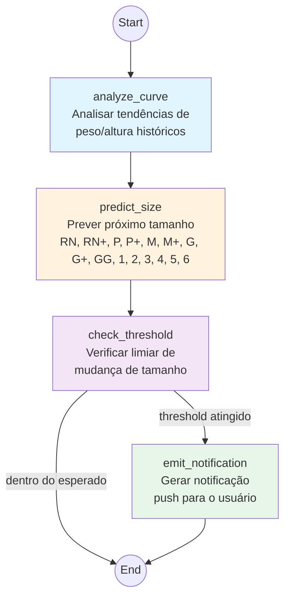

## 6. Diagrama de Rotas da Aplicação (SvelteKit)

```mermaid
graph TB
  subgraph Routes["apps/web — Rotas SvelteKit"]
    HOME["/ — redirect para /catalog"]
    LOGIN["/login — AuthScreen + RegistrationForm"]
    CATALOG["/catalog — Catálogo com filtros"]
    CATALOG_ID["/catalog/[id] — Detalhe do item"]
    CHAT["/chat — Assistente IA com SSE"]
    CHILD["/child — Lista de crianças"]
    CHILD_REGISTER["/child/register — Cadastro"]
    CHILD_ID["/child/[id] — Gráfico de crescimento"]
    NOTIFICATIONS["/notifications — Central"]
    SELL["/sell — Formulário 2-step"]
    PROFILE["/profile — Perfil + idioma"]
    TERMS["/terms — Termos de uso"]
    PRIVACY["/privacy — Política de privacidade"]
  end

  LAYOUT["+layout.svelte<br>TopBar + BottomNav + Footer"]
  LAYOUT_SERVER["+layout.server.ts<br>Session + locale loader"]

  LAYOUT --> HOME
  LAYOUT --> LOGIN
  LAYOUT --> CATALOG
  LAYOUT --> CATALOG_ID
  LAYOUT --> CHAT
  LAYOUT --> CHILD
  LAYOUT --> CHILD_REGISTER
  LAYOUT --> CHILD_ID
  LAYOUT --> NOTIFICATIONS
  LAYOUT --> SELL
  LAYOUT --> PROFILE
  LAYOUT --> TERMS
  LAYOUT --> PRIVACY
  LAYOUT --> LAYOUT_SERVER
```

## 7. Diagrama de Roteamento da API (Elixir Plug)

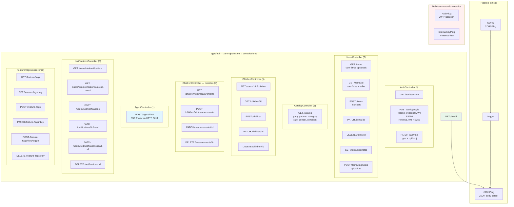

## 8. Diagrama Entidade-Relacionamento (Ecto Schemas)

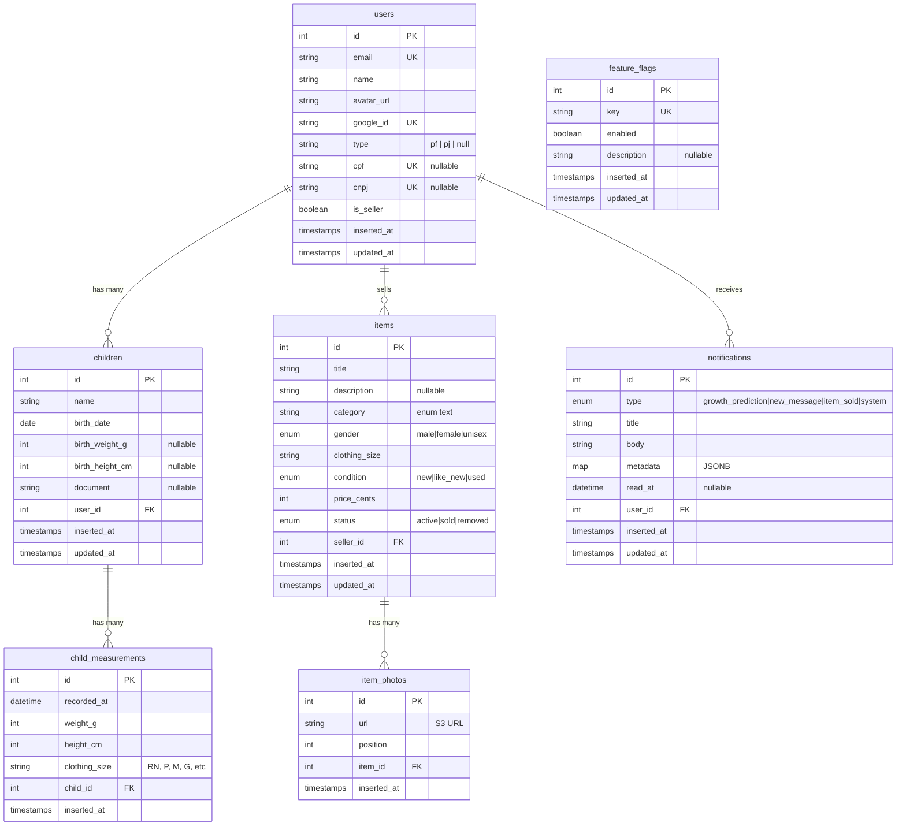

## 9. Diagrama de Migrações (10 migrations)

```mermaid
graph LR
  M1["01_create_users"]
  M2["02_create_items"]
  M3["03_create_item_photos"]
  M4["04_create_children"]
  M5["05_create_child_measurements"]
  M6["06_create_notifications"]
  M7["07_create_feature_flags"]
  M8["08_add_type_to_users"]
  M9["09_add_cpf_cnpj_to_users"]
  M10["10_add_category_gender_to_items"]

  M1 --> M2
  M2 --> M3
  M3 --> M4
  M4 --> M5
  M5 --> M6
  M6 --> M7
  M7 --> M8
  M8 --> M9
  M9 --> M10

  style M1 fill:#e8f5e9
  style M8 fill:#fff3e0
  style M9 fill:#fff3e0
  style M10 fill:#e1f5fe
```

## 10. Clean Architecture — Frontend (apps/web)

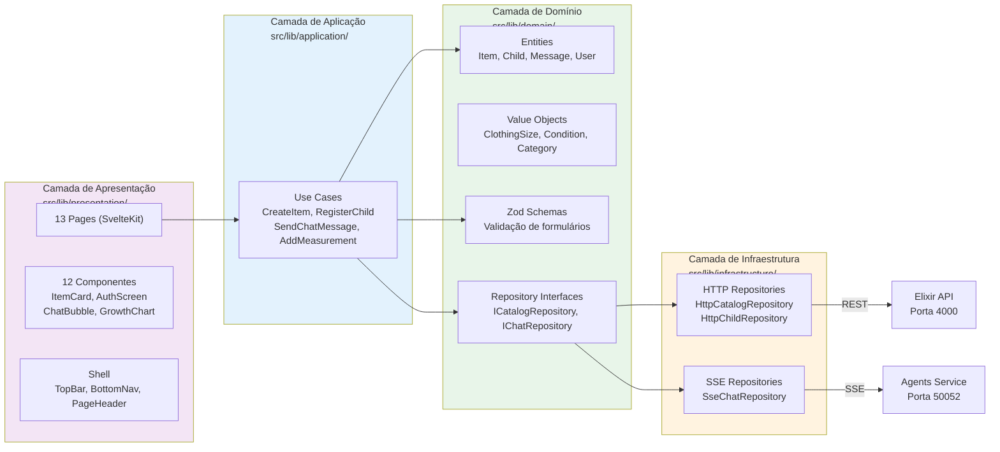

## 11. Mapa de Tecnologias

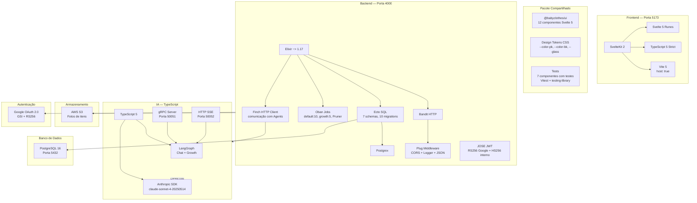

## 12. Diagrama de Containers (Docker)

```mermaid
graph TB
  subgraph Docker["docker compose"]
    PG[(postgres:16-alpine<br>Porta 5432)]
    API[api<br>Porta 4000<br>elixir:1.17-alpine]
    AGENTS[agents<br>Porta 50051 (gRPC)<br>Porta 50052 (SSE)<br>node:22-alpine]
    WEB[web<br>Porta 5173<br>node:22-alpine]
  end

  PG -->|volume| DATA[(postgres_data)]
  API -->|depends_on| PG
  AGENTS -->|depends_on| API
  WEB -->|depends_on| API

  subgraph Networks["babyclothes network"]
    PG
    API
    AGENTS
    WEB
  end

  style PG fill:#f96
  style API fill:#6cf
  style AGENTS fill:#9c6
  style WEB fill:#f9f
```

---

*Documento gerado em 2026-06-26.*
